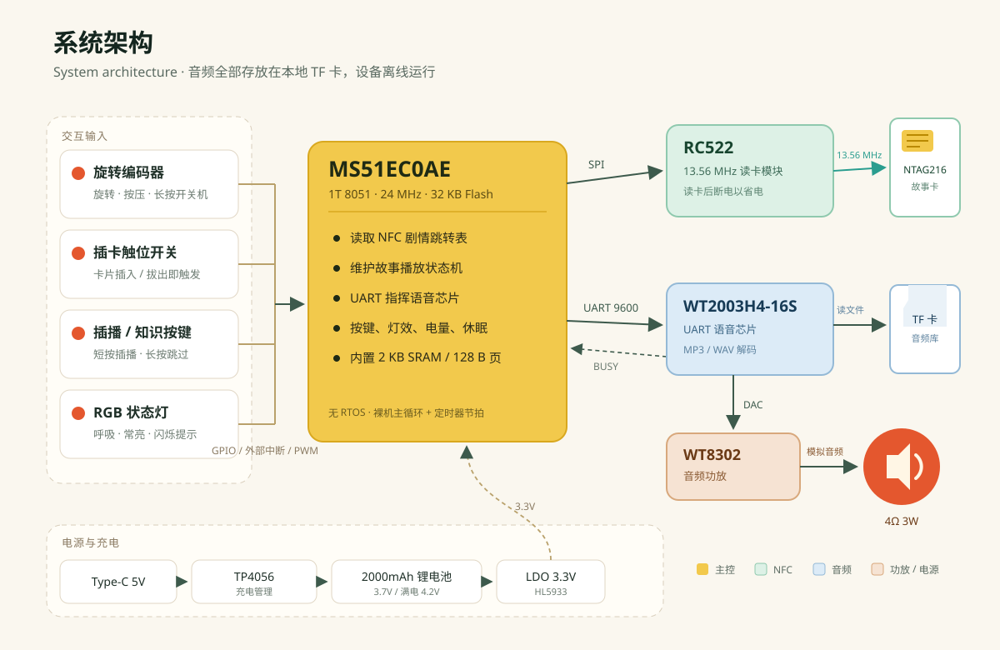
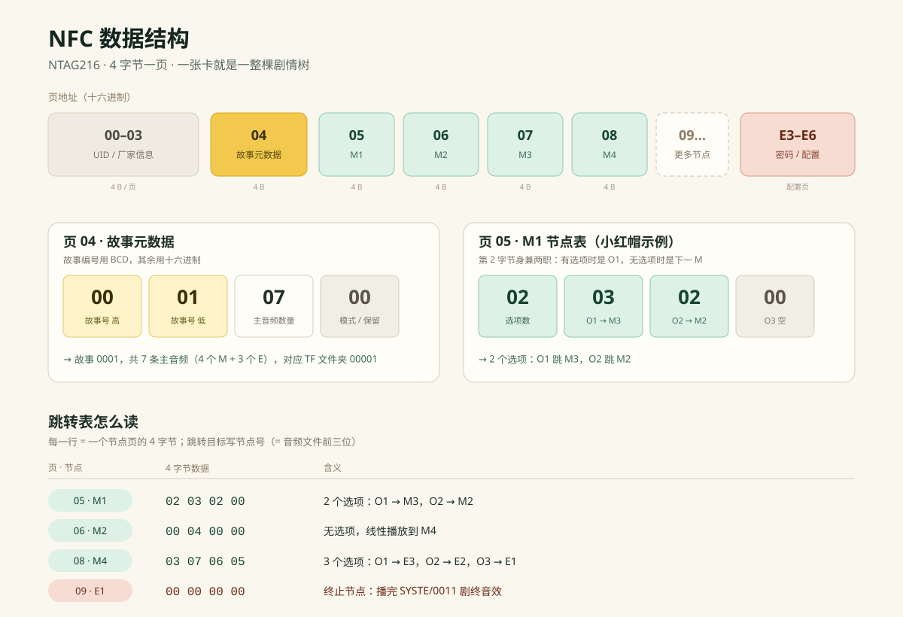
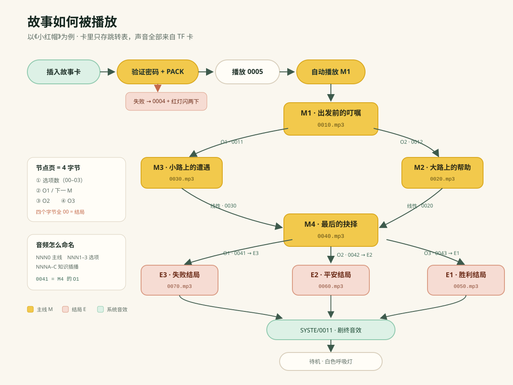

<p align="center"></p>

<h1 align="center">Story Machine</h1>

<p align="center">Screen-free · NFC cards · Branching audio stories · Fully offline</p>

<p align="center"><a href="README.md">简体中文</a> | <strong>English</strong></p>

<p align="center"></p>

> One NFC card is one story world. Insert the card, turn the knob, press to choose — the story follows the child.

---

## Contents

- [1. What is this?](#1-what-is-this)
- [2. How it works](#2-how-it-works)
- [3. Hardware](#3-hardware)
- [4. Architecture](#4-architecture)
- [5. Data format](#5-data-format)
- [6. Quick start](#6-quick-start)
- [7. Build the firmware](#7-build-the-firmware)
- [8. Make a new story](#8-make-a-new-story)
- [9. Repository layout](#9-repository-layout)
- [10. V1.0 vs V2.0](#10-v10-vs-v20)
- [11. Known limitations](#11-known-limitations)
- [12. Before you publish](#12-before-you-publish)
- [13. Contributing](#13-contributing)
- [14. License and safety](#14-license-and-safety)
- [15. Credits](#15-credits)

---

## 1. What is this?

Story Machine is a **screen-free, interactive audio storyteller for children aged 4–8**. It turns story selection into inserting a card, and plot progression into turning and pressing a knob.

- **The NFC card is the story cartridge.** It stores no audio — only a table of story nodes, branches, and jump targets.
- **The TF card is the audio library.** Narration, dialogue, sound effects, and knowledge clips are MP3/WAV files named with a four-character scheme.
- **The MCU is the director.** It reads the card, tracks the story state, and sends UART commands to a voice chip. When a track finishes (the BUSY pin goes low), it decides what plays next.
- **The child is the protagonist.** At a decision point, they turn the knob to preview options and press to confirm; the story continues along their choice.

Everything runs offline. No screen, no microphone, no camera, no app, no account, no subscription.

### Open-source status

| Item | Status |
|---|---|
| V1.0 firmware source (Keil C51 / MS51) | Open |
| V1.0 hardware files | PCB, pick-and-place data, and production hex are included; the BOM and enclosure ZIPs are omitted for privacy/size reasons — see [docs/EXCLUDED.md](docs/EXCLUDED.md) |
| NFC / TF / UART protocol docs | Open |
| Sample story scripts (*Little Red Riding Hood*, *Village Quest*) | Scripts and encoding examples included; audio omitted for copyright reasons |
| V2.0 firmware source | **Not open** — only a production hex |
| Third-party voice recordings | **Removed from this release** — not covered by the license |

> This repository is centered on **V1.0 (option insertion)**. V2.0 (main-track insertion) is documented and shipped as a hex only; see §10.

---

## 2. How it works

1. Long-press the knob to power on. The knob ring starts a white breathing light.
2. With no card inserted, turn the knob to set one of 10 volume levels.
3. Insert a story card. A snap switch in the slot detects the card.
4. The device verifies the card's password and PACK, plays a confirmation sound, then starts M1.
5. When a main track ends at a decision point, the ring breathes white. Turn the knob to preview O1/O2/O3.
6. Press the knob to confirm; the story jumps to the selected node.
7. Short-press the insert key during option preview to hear a related knowledge clip (V1).
8. Remove the card to stop immediately. Long-press the knob to power off.

| Control | Action |
|---|---|
| Long-press knob | Power on / off |
| Turn knob, no card | Volume (10 levels) |
| Insert card | Verify and start story |
| Short-press knob while playing | Pause / resume |
| Turn knob at decision point | Preview options |
| Press knob at decision point | Confirm choice |
| Short-press insert key | Play knowledge clip while previewing options (V1) |
| Long-press insert key | Skip the rest of current main track |
| Remove card | Stop and return to standby |

---

## 3. Hardware

| Story_machine V1.3 main board | RC522 Mini reader (dimensions) |
|---|---|
|  |  |

| Part | Model / spec | Notes |
|---|---|---|
| MCU | Nuvoton **MS51EC0AE** (1T 8051, 24 MHz, 32 KB Flash, 2 KB SRAM, SOP-28) | No external flash; bare-metal loop |
| NFC reader | **RC522 Mini** module | SPI, 13.56 MHz; module LED removed in production to save power |
| NFC card | **NTAG216** (868 B domestic / 888 B imported) | ISO 14443-3A, password-protected |
| Voice chip | **WT2003H4-16S** (SOP-16, TF-card version A02) | UART-controlled MP3/WAV decoder |
| Amplifier | WT8302 (SOP-8) | Drives a 4 Ω / 3 W speaker |
| Charger | TP4056 (1 A) | Provides CHRG / STDBY status to the MCU |
| LDO | HL5933XR (3.3 V, 500 mA) | |
| Knob | RGB push encoder `ED1273S-RGB-24P-24LC-Y20A7` | Rotation + press + RGB ring |
| Storage | TF card C10 (BOM: 16 GB; PRD: 32 GB) | FAT32, holds all audio |
| Battery | 2000 mAh / 3.7 V Li-ion with protection board | 4.2 V when full |
| Speaker | 4 Ω / 3 W (V1 wired; V2 Φ2.5 cm internal-magnet) | |
| Key | 6×6×9 tactile switch with LED | Insert / knowledge key |

### Faceplate variants

| 35 mm adventure | 35 mm base | 69 mm sci-fi |
|---|---|---|
|  |  |  |

### Pin map

| Function | Pin | Function | Pin |
|---|---|---|---|
| RC522 RST | P2.3 | Encoder A (INT0) | P3.0 |
| RC522 NSS | P1.1 | Encoder B (INT1) | P1.7 |
| RC522 SCK | P1.2 | Knob press | P3.4 |
| RC522 MOSI | P3.5 | Card-slot switch | P0.3 |
| RC522 MISO | P2.1 | Insert / knowledge key | P3.3 |
| Voice chip TX | P0.6 (UART0 TX) | Insert key LED | P2.4 |
| Voice chip RX | P0.7 (UART0 RX) | RGB R / G / B | P0.1 / P0.0 / P1.0 |
| Voice chip BUSY | P0.4 | CHRG detect | P2.5 |
| Battery ADC | P0.5 | STDBY detect | P1.4 |

> RGB is common-cathode: **1 = on, 0 = off**. Flash with a Nu-Link Plus through the 5-pin header (3.3V / GND / RX / TX / GND).

<p align="center"></p>
<p align="center"><sub>2000 mAh Li-ion battery (refer to the physical part for dimensions)</sub></p>

---

## 4. Architecture

<p align="center"></p>

Design notes:

- **The MCU never decodes audio.** It sends `A5` playback commands over UART; the WT2003H4-16S reads the TF card, decodes the file, and outputs analog audio through the WT8302 amplifier.
- **BUSY drives the state machine.** BUSY is high while a track plays. Its falling edge tells the MCU that the track has ended.
- **The RC522 is powered down after each read** (`MF522_RST = 0`) to save standby power. The card-slot switch decides when to read again.
- **All content is local.** New stories require no network — just a new card or TF folder.

---

## 5. Data format

### 5.1 NFC card: one page = 4 bytes

<p align="center"></p>

NTAG216 is read and written in **pages of 4 bytes**. What the original docs call a "sector / 4 blocks" is really one page / four bytes. The firmware's `PcdRead()` returns 16 bytes, but the application only uses the first four.

**Page 04 — story metadata**

| Byte | Field | Notes |
|---|---|---|
| 1 | Story ID high | BCD-encoded two-digit decimal, e.g. `0x10` = "10" |
| 2 | Story ID low | e.g. `0x01` = "01" |
| 3 | Main-track count | Hexadecimal, including ending tracks |
| 4 | Mode / reserved | `00` in V1; used as a mode flag in V2 |

The story ID is concatenated as a string: `0x10,0x01 → "1001"`; the TF folder prepends a fixed `0`, giving `01001`. The V1 firmware only supports story IDs 1–99 in practice — see §11.

**Page 05 onward — one page per main node**

| Byte | Field | Notes |
|---|---|---|
| 1 | Option count | `00`–`03`; in V2 the high nibble is an insertion flag |
| 2 | O1 / next M | With options: O1 target. Without options: next M node |
| 3 | O2 | O2 target |
| 4 | O3 | O3 target |

- A jump target is the **node number**, which equals the first three digits of the audio filename. M4 → `0040.mp3` → node `04`.
- **`00 00 00 00` marks an ending node.** After it plays, the device plays `SYSTE/0011.mp3` and returns to standby.

**Password and configuration pages**

| Page | Data | Meaning |
|---|---|---|
| E3 | `04 00 00 00` | Enable password protection |
| E4 | `00 05 00 00` | Allow 5 wrong attempts |
| E5 | `31 35 39 30` | Password ASCII **"1590"** (mini: "0951") |
| E6 | `32 32 00 00` | PACK ASCII **"22"** |

### 5.2 TF card: folders and four-character filenames

```
TF card root/
├─ SYSTE/                 System sounds (fixed uppercase folder)
│  ├─ 0001.mp3            Power on
│  ├─ 0002.mp3            Power off
│  ├─ 0003.mp3            Volume
│  ├─ 0004.mp3            Card error
│  ├─ 0005.mp3            Card OK
│  ├─ 0006.mp3            Card removed
│  ├─ 0007.mp3            Skip
│  ├─ 0008.mp3            Idle reminder
│  ├─ 0009.mp3            Battery ≤ 20%
│  ├─ 0010.mp3            Battery ≤ 10%
│  └─ 0011.mp3            The End
└─ 00001/                 Story folder: 0 + story ID
   ├─ 0010.mp3            M1 main track
   ├─ 0011.mp3            M1 / O1
   ├─ 0012.mp3            M1 / O2
   ├─ 001A.mp3            M1 / K1 (V1)
   ├─ 0020.mp3            M2 main track
   └─ ...
```

| Type | Name | Example |
|---|---|---|
| Main M / ending E | node (3 digits) + `0` | M1 → `0010.mp3`, M4 → `0040.mp3` |
| Option O | node + `1`–`3` | M4 / O2 → `0042.mp3` |
| Knowledge K (V1) | node + `A`–`C` | M4 / K1 → `004A.mp3` |

Audio: MP3/WAV, 8 kHz–44.1 kHz, mono, 8–320 kbps; MP3 recommended. Keep clips under 60 seconds where possible to avoid interactions with the idle timer.

### 5.3 Voice chip: UART frame

```
7E | length | command | arguments ... | checksum | EF
```

The checksum is the low 8 bits of the sum from the length byte through the last argument. Main commands used by the firmware:

| Command | Purpose | Used for |
|---|---|---|
| `A5` | Play by folder + filename | Story audio, system sounds |
| `AA` | Pause / resume | Knob short press |
| `AB` | Stop | Reserved |
| `AE` | Volume 0–31 (persisted) | 10-level volume mapping |
| `B1` | Insert during playback, resume afterwards | Reserved |
| `B6` | Output select: 00 = SPK, 01 = DAC | Switch to DAC at boot |

```c
volume_Play_TF(story, node, option);        // story audio
volume_Play_TF_option(story, node, option); // K clip for an option (V1)
volume_Play_TF_SYS(0, 0, 0, 5);             // SYSTE/0005.mp3
```

### 5.4 A story walkthrough

<p align="center"></p>

Using *Little Red Riding Hood*:

1. Insert card → verify password + PACK → play `0005`.
2. Read page 05 (M1) → play `0010`.
3. M1 ends with two options → preview `0011` (O1) / `0012` (O2).
4. Choose O1 → M3 → `0030`; choose O2 → M2 → `0020`.
5. M2 and M3 have no options; byte 2 points to M4 → auto-play `0040`.
6. M4 has three options → E3 / E2 / E1 → `0070` / `0060` / `0050`.
7. An ending node is `00 00 00 00` → after playback, `SYSTE/0011.mp3` plays, then standby.

---

## 6. Quick start

### 6.1 You need

- A Story_machine V1.3 board or assembled unit
- Nu-Link Plus programmer + 5-pin cable
- TF card (FAT32, C10 recommended)
- Blank NTAG216 cards
- An Android phone with NFC Tools Pro
- 4 Ω / 3 W speaker and 2000 mAh battery (for a bare board)
- Keil uVision 5 + C51 (only if you modify firmware)

### 6.2 Flash the MCU

| Flashing connection | Nu-Link Plus and board |
|---|---|
|  |  |

1. Connect the Nu-Link Plus to the 5-pin header (3.3V / GND / RX / TX / GND).
2. Open `V1.0 .../开发文件/软件/Story_machine/Project/Story_machine.uvproj`.
3. Rebuild; the output is `Output/Story_machine V1.hex`.
4. Flash with the Nuvoton tool or Keil's flash download.
5. For production, use `生产文件/MCU主控程序/Story_machine 251117 L1.hex`; its checksum is in `校验码：56cc.txt`.

### 6.3 Prepare the TF card

1. Format as FAT32.
2. Extract `V1.0 .../代码烧录1114/TF卡文件.zip` and copy `SYSTE/` and `00001/` to the root.
3. Keep filenames numeric/uppercase and consistent with the NFC jump table.
4. Keep a master copy and clone it for production.

### 6.4 Write an NFC card

Use **NFC Tools Pro** → Other → Advanced NFC commands → **TAG TYPE2 (ISO14443-3A)** → **Write4bytes**.

```
A2:page:b1:b2:b3:b4     // write 4 bytes to one page
1B:31:35:39:30          // verify password "1590" (first line for locked cards)
```

<p align="center"></p>
<p align="center"><sub>NFC Tools Pro command list (historical screenshot; use the commands in this document)</sub></p>

Complete *Little Red Riding Hood* example (story 0001, 7 main tracks):

```
1B:31:35:39:30,
A2:04:00:01:07:00,
A2:05:02:03:02:00,
A2:06:00:04:00:00,
A2:07:00:04:00:00,
A2:08:03:07:06:05,
A2:09:00:00:00:00,
A2:0A:00:00:00:00,
A2:0B:00:00:00:00
```

> Confirm the card is NTAG216, write, then read it back and verify page 04 and every node page. Password operations can lock a card; back up the original data first.

### 6.5 Power-on check

1. Power-on sound `SYSTE/0001.mp3`; white breathing ring.
2. Turn the knob with no card → volume beep `0003`; red flash at min/max.
3. Insert card → `0005` → M1 starts automatically.
4. Remove card → immediate stop + `0006` → breathing standby.

### 6.6 Troubleshooting

| Symptom | Likely cause | Check |
|---|---|---|
| No sound at all | TF format/layout; voice chip not running | FAT32, `SYSTE/`, speaker and amp wiring |
| No reaction to card | Slot switch not pressed; RC522 cable loose | P0.3 level, 8-pin cable, insertion depth |
| Card error (0004) | Wrong password/PACK; not NTAG216 | Rewrite E3–E6; read the card with a phone |
| Wrong file / silence | Node number ≠ filename prefix | Jump target must equal first three digits |
| No auto-advance | BUSY stuck; corrupt audio | Try another clip; check `P0.4` |
| Build error | GBK source; wrong Keil version | Open as GBK; Keil C51 PK51 9.57+ |
| Debug logs disturb playback | UART0 shared with voice chip | Disable `UART0_DEBUG` or disconnect voice-chip TX |

---

## 7. Build the firmware

| Item | Value |
|---|---|
| Project | `V1.0 .../开发文件/软件/Story_machine/Project/Story_machine.uvproj` |
| IDE | Keil uVision 5 (build log: V5.24.2) |
| Compiler | C51 PK51 9.57 |
| Device | `MS51EC0AE`, 24 MHz |
| Output | `Output/Story_machine V1.hex` |
| Current size | code ≈ 17.5 KB, xdata ≈ 511 B (2 KB SRAM) |
| Source encoding | **GBK** (UTF-8 will look garbled) |

- `UART0_DEBUG` and `RC522_DEBUG` are off by default. UART0 shares P0.6/P0.7 with the voice chip; debug text can be interpreted as commands.
- 8051 RAM/XDATA is tight. Estimate memory before adding global arrays or strings.
- `tempCodeRunnerFile.c/h` are empty editor leftovers and can be deleted.
- There is no RTOS and no unit test suite. Run the full device test checklist after any firmware change.

---

## 8. Make a new story

### 8.1 Write the script: M / O / K / E

| Tag | Meaning | Constraint |
|---|---|---|
| `M` | Main story node | Number sequentially from M1 |
| `O` | Decision option | Up to 3 per M |
| `K` | Knowledge insert (V1) | One per option: O1 → K1 |
| `E` | Ending | Treated as M, marked as a terminal node in NFC |

Write a "linear playback" script first: for every node, state where it goes when the track ends. Then convert it to the jump table. A template is in `V1.0 .../其他资料/小红帽.../小红帽故事脚本-线性播放版.md`.

### 8.2 Name the audio

Use `NNN0` for main tracks, `NNN1`–`NNN3` for options, `NNNA`–`NNNC` for knowledge clips. The node number and the first three filename digits must match (see [§5.2](#52-tf-card-folders-and-four-character-filenames)).

### 8.3 Build the jump table

Each M node is four bytes:

```
[option count] [O1 / next M] [O2] [O3]
```

A minimal three-node story:

| Page | Data | Meaning | Audio |
|---|---|---|---|
| 04 | `00 01 03 00` | Story 0001, 3 main tracks | — |
| 05 | `00 02 00 00` | M1, no options → M2 | `0010.mp3` |
| 06 | `00 03 00 00` | M2, no options → E1 (node 3) | `0020.mp3` |
| 07 | `00 00 00 00` | E1, terminal | `0030.mp3` |

Write commands:

```
1B:31:35:39:30,
A2:04:00:01:03:00,
A2:05:00:02:00:00,
A2:06:00:03:00:00,
A2:07:00:00:00:00
```

### 8.4 Checklist

- [ ] Every jump target has a matching audio file
- [ ] Every ending is `00 00 00 00`
- [ ] Story folder = `0` + NFC story ID
- [ ] `SYSTE/0001`–`0011` are present
- [ ] One main track, one option, and one ending have been played end to end
- [ ] Card removal, pause, skip, and low battery have been tested

> A deeper Chinese technical manual is available at [项目说明与二次开发指南](项目说明与二次开发指南.md).

---

## 9. Repository layout

```
game story/
├─ README.md                    Chinese README
├─ README.en.md                 This file
├─ LICENSE                      MIT
├─ 项目说明与二次开发指南.md     Deep technical manual (Chinese)
├─ docs/
│  ├─ images/                   SVG diagrams (photos are referenced in place)
│  └─ EXCLUDED.md               What this release omits, and why
├─ V1.0 选项插播 20251125/
│  ├─ audio storyV1.0.md       V1 PRD and encoding spec
│  ├─ NFC写入教程/              Data tables and command examples
│  ├─ 代码烧录1114/             Flashing photos and production hex
│  ├─ 结构与外观/外观设计/      Three faceplate renders
│  ├─ 开发生产文件/故事机251117 L1.0/
│  │  ├─ 开发文件/硬件/         Altium PCB
│  │  ├─ 开发文件/软件/         Keil C51 project and source
│  │  ├─ 开发文件/语音/         WT2003 manual, NFC/TF spreadsheets
│  │  ├─ 生产文件/              Production hex, PCB, pick-and-place
│  │  └─ 硬件型号与规格/        NFC module, battery photos
│  └─ 其他资料/                 Sample scripts (no audio)
└─ V2.0 主音插播 20251213/
   ├─ audio storyV2.0.md       V2 PRD (ISTORY / ISTORY mini)
   ├─ 优化记录.docx            V2 change log
   ├─ [1]代码及烧录/            V2 production hex (no source)
   ├─ [2]NFC编码及写入/         V2 NFC data structure
   └─ [5]内容及示例/村庄任务/   Sample script and commands (no audio)
```

---

## 10. V1.0 vs V2.0

| Item | V1.0 Option insert | V2.0 Main-track insert |
|---|---|---|
| Insert target | Knowledge K attached to option O | Knowledge attached to main track M (`NNNA`) |
| After insert | Wait for the next command | Restart the current M automatically |
| Option-wait light | White breathing, solid after confirm | Off while playing, white breathing at decision point |
| Idle / pause shutdown | Reminders at 60/120 s, off at 180 s | 3 min at decision point, 30 min paused, silent |
| Low battery | Sound + light at ≤20%, off at ≤10% | Red flash only at ≤20%, off at ≤10% |
| Night light | No | Yes, via knob or insert key |
| Product line | 6–12 years, single mode | ISTORY 6–12 + ISTORY mini 3–5 |
| Source code | **Yes** | **No, hex only** |

V2 NFC changes:

- Page 04 byte 4: `01` = with insertion, `02` = without.
- Node page byte 1 high nibble = insertion flag: `0x13` = insert + 3 options, `0x10` = insert + 0 options.
- Insertion audio is always "current M node + A", e.g. M4 → `004A.mp3`.
- ISTORY mini only validates files and plays them sequentially; no M/O jumps.

> V2 ships without source. To modify V2 behavior, obtain the source from the original developer or port the features back to the V1 codebase. The meaning of `10 00 00 00` for M4 in the V2 sample is ambiguous in the docs; verify on hardware before changing anything.

---

## 11. Known limitations

1. **Story IDs are effectively limited to 1–99.** `volume_Play_TF()` sends `"00" + 3-digit story ID` and computes `file_tens = file / 10` without a modulo. IDs ≥100 produce invalid characters. Supporting five-digit folders such as `01001` requires rewriting the function.
2. **Node numbers are effectively limited to 1–99.** `byte1_hundreds = file / 100` uses the story ID instead of the node number. The PRD's 255-node claim does not match the code.
3. **UART receive buffer can overflow.** `RevBuffer[30]`, but the ISR allows `Uart_data_lenght` to reach 80. Clamp it to 30 or enlarge the buffer.
4. **No anti-cloning.** Only a fixed password (1590) and fixed PACK ("22"). Anyone with the password can copy a card. The PRD's "dynamic code" is not implemented.
5. **No progress memory.** Removing the card clears all state. The PRD's "NFC progress save" is not implemented.
6. **Docs disagree with each other**: system-sound numbering (0001–0011 vs 1001–1010), whether V2 removed K clips, TF card size (16 GB vs 32 GB), long-press duration (1 s vs 3 s), and the *Little Red Riding Hood* main-track count (sheet says 6, command says 7, actual audio is 7). Trust the code and the device.
7. **Audio length and BUSY jitter** affect the state machine. Keep clips under 60 seconds and preserve the `Busy_time` debounce.
8. **V2 has no source**, and the `0x10` node in the V2 sample is ambiguous.

---

## 12. Before you publish

> This release already omits third-party audio, commercial material, and oversized enclosure files. See [docs/EXCLUDED.md](docs/EXCLUDED.md). If you maintain the full development tree, still check every item below.

This repository mixes development, production, commercial, and third-party content. **Check every item before making it public:**

- [ ] Remove third-party audio such as the `晚安妈妈` recordings under `其他资料/3-5/`
- [ ] Remove commercial material: `investor_pitch.md`, parent research, quotes, supply-chain docs
- [ ] Redact supplier names, phone numbers, prices, and costs in the BOM
- [ ] Remove faces, phone numbers, company names, and workstation details from photos/videos
- [ ] Verify the edition/annotation rights of the public-domain novel texts
- [ ] Confirm sample audio is self-produced, AI-generated with commercial rights, or licensed
- [ ] Reinitialize `.git` or purge sensitive files from history (deleting the current file is not enough)
- [ ] Move large videos/audio/ZIPs to Git LFS or release attachments
- [ ] Confirm PCB, enclosure, and BOM can be public; otherwise remove those directories
- [ ] Confirm appearance renders and supplier dimension drawings (e.g. the RC522 module image) can be public, or replace them with your own drawings
- [ ] Confirm the cartoon characters/IP in the faceplate renders are yours, or replace them with artwork you can license
- [ ] README photos reference the original development folders; if you remove those folders, move the images to `docs/images/` and update the links
- [ ] Add `LICENSE`, `CONTRIBUTING.md`, and `SECURITY.md`
- [ ] Add a children's-product safety notice and a "not a toy" disclaimer
- [ ] Decide how the project name and any trademarks may be used

> Open-sourcing code does not grant rights to trademarks, voice recordings, story IP, or business data. State the scope of each license clearly.

---

## 13. Contributing

Issues and pull requests are welcome. Good starting points:

- **Content toolchain**: script (M/O/K/E) → NFC `A2` commands + TF filename checker
- **Fix encoding limits**: support five-digit story folders and three-digit node numbers
- **Card self-check**: validate jump targets and audio existence after reading a card; play `0004` on failure
- **Port V2 features**: main-track insertion, mode flag, night light, silent shutdown
- **Documentation**: reconcile the PRD, spreadsheets, and code

Before submitting:

1. State which layer you changed (content / firmware / hardware / tooling).
2. For firmware changes, include test results covering main track, options, endings, card removal, pause, and low battery.
3. Do not commit audio, images, or fonts with unclear rights.
4. Keep the project buildable with Keil C51; keep GBK or convert consistently and note it in the PR.

---

## 14. License and safety

**Code and documentation** are released under the [MIT License](LICENSE). You may use, modify, and distribute them, including commercially, provided the copyright and permission notices are retained.

**Not covered by MIT**:

- Third-party voice recordings, music, and sound effects
- Third-party story IP, characters, and artwork
- Project names, logos, and trademarks
- Files that carry their own license notice
- Third-party documents such as the WT2003 manual (copyright remains with the vendor)

**Hardware and safety**: hardware files are provided "as is" without warranty. This is a children's product involving a Li-ion battery, charging, a speaker, and small parts:

- Complete battery, charging, temperature, drop, and pinch-point testing, plus required certifications, before mass production.
- Not suitable for children under 3; small parts are a choking hazard.
- Limit volume and avoid prolonged high-volume use.
- Guardians should review story content for age appropriateness.

**Disclaimer**: this project is for learning, research, and personal builds. Any risk or loss from self-manufacturing, modification, or use is borne by the user.

---

## 15. Credits

- Nuvoton MS51 MCU family and official SDK
- Waytronic WT2003H4-16S voice chip and documentation
- The RC522 / MFRC522 open-source community
- Everyone who wrote, voiced, designed, assembled, and tested the stories

If this project helps you, star the repo, open an issue, or build a story world of your own.
