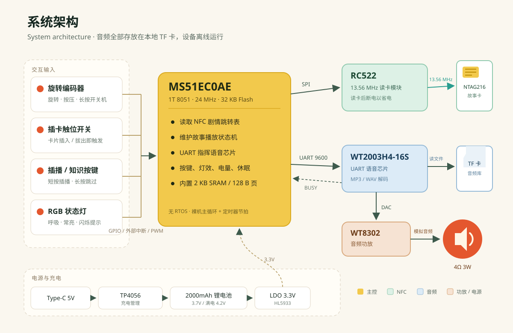
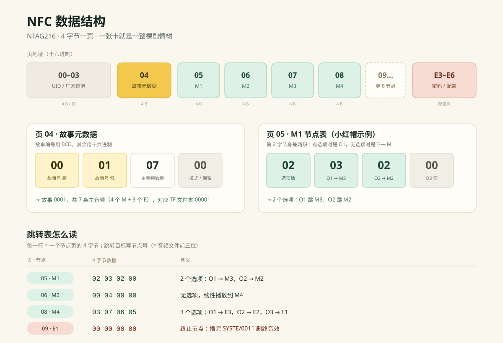
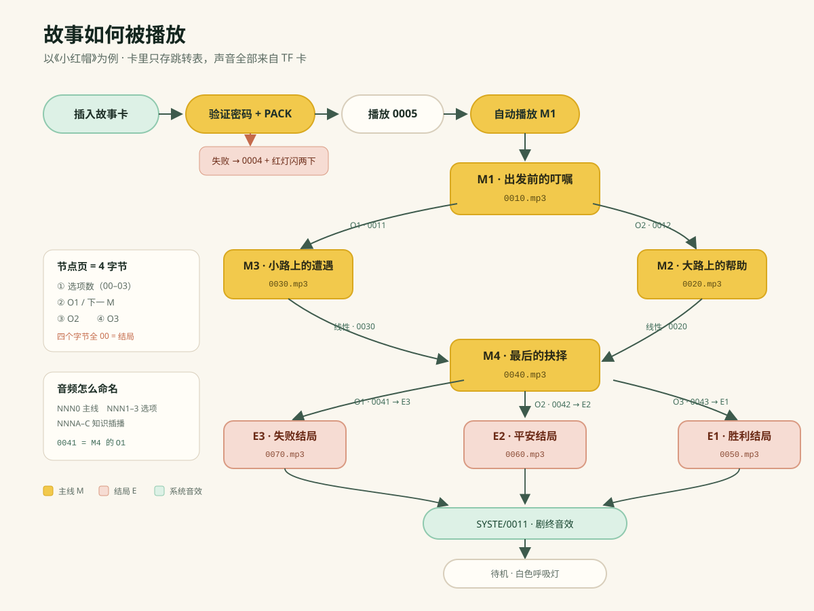

<p align="center"></p>

<h1 align="center">冒险故事机 · Story Machine</h1>

<p align="center">无屏 · NFC 卡片 · 互动分支故事 · 完全离线</p>

<p align="center"><strong>简体中文</strong> | <a href="README.en.md">English</a></p>

<p align="center"></p>

> 一张 NFC 卡就是一个故事世界。插卡开始，旋转选择，按下确认——故事跟着孩子的选择走。

---

## 目录

- [1. 这是什么](#1-这是什么)
- [2. 怎么玩](#2-怎么玩)
- [3. 硬件](#3-硬件)
- [4. 系统架构](#4-系统架构)
- [5. 工作原理](#5-工作原理)
- [6. 快速开始](#6-快速开始)
- [7. 构建固件](#7-构建固件)
- [8. 制作一个新故事](#8-制作一个新故事)
- [9. 仓库结构](#9-仓库结构)
- [10. V1.0 与 V2.0](#10-v10-与-v20)
- [11. 已知限制](#11-已知限制)
- [12. 开源前清理清单](#12-开源前清理清单)
- [13. 参与贡献](#13-参与贡献)
- [14. 许可证与安全声明](#14-许可证与安全声明)
- [15. 致谢](#15-致谢)

---

## 1. 这是什么

冒险故事机是一台给 4–8 岁儿童使用的**无屏互动有声故事机**。它把"选故事"变成插卡，把"推动剧情"变成旋转和按压：

- **NFC 卡是故事卡**。卡里不存音频，只存一张"剧情跳转表"：当前播到哪个节点、有几个选项、每个选项跳到哪里。
- **TF 卡是音频库**。所有旁白、对白、音效、知识讲解都以 MP3/WAV 存放在 TF 卡里，按 4 位数字命名。
- **MCU 是导演**。它读卡、维护故事状态、通过 UART 指挥语音芯片播放对应文件；一段音频播完（BUSY 引脚变低），再决定下一步。
- **孩子是主角**。故事进行到决策点时，旋转旋钮逐个试听选项，按下确认，剧情就沿着选择继续。

设备完全离线运行：没有屏幕、没有麦克风、没有摄像头、不需要 App、不需要账号，也没有订阅。

### 开源状态

| 内容 | 状态 |
|---|---|
| V1.0 主控固件源码（Keil C51 / MS51） | 已开源 |
| V1.0 硬件资料 | PCB、贴片资料、量产 hex 已包含；BOM 与结构 ZIP 因商业信息/体积未包含，见 [docs/EXCLUDED.md](docs/EXCLUDED.md) |
| NFC / TF / UART 协议与编码文档 | 已开源 |
| 示例故事脚本《小红帽》《村庄任务》 | 脚本与编码示例已包含；音频因版权未包含 |
| V2.0 主控固件源码 | **未开源**，仓库只提供量产 hex |
| 第三方配音（如"晚安妈妈"系列） | **已从发布版移除**，不属于开源范围 |

> 本仓库以 **V1.0（选项插播）** 为实现核心；V2.0（主音插播）只提供差异说明与量产固件，详见[第 10 节](#10-v10-与-v20)。

---

## 2. 怎么玩

1. 长按多功能旋钮约 1–3 秒开机，听到开机音效，旋钮灯开始白色呼吸。
2. 未插卡时旋转旋钮，可在 10 级音量之间调节；每转一级都有提示音。
3. 把故事卡插入卡槽，卡槽内的触位开关被压住，设备开始验证卡片。
4. 验证通过后播放"验证通过"音效，随后自动播放第一个主线音频 M1。
5. 主线播完、进入决策点时，旋钮灯变为白色呼吸；旋转可循环试听选项 O1、O2、O3。
6. 按下旋钮确认选择，剧情跳转到该选项对应的下一个主线节点。
7. 选项试听时，短按插播键可听一段与当前选项相关的知识音频（V1 玩法）。
8. 拔出卡片，故事立即停止并播放"拔卡"音效；长按旋钮关机。

| 操作 | 功能 |
|---|---|
| 长按旋钮 | 开机 / 关机 |
| 未插卡时旋转 | 音量调节（10 级） |
| 插卡 | 验证卡片并开始故事 |
| 主线播放时短按旋钮 | 暂停 / 续播 |
| 决策点旋转 | 试听选项 |
| 决策点按下旋钮 | 确认选择 |
| 短按插播键 | 选项试听时播放知识音频（V1） |
| 长按插播键 | 跳过当前主线剩余部分 |
| 拔卡 | 停止播放，回到待机 |

---

## 3. 硬件

| Story_machine V1.3 主板 | RC522 Mini 读头（尺寸图） |
|---|---|
|  |  |

| 部件 | 型号 / 规格 | 说明 |
|---|---|---|
| 主控 MCU | Nuvoton **MS51EC0AE**（1T 8051，24 MHz，32 KB Flash，2 KB SRAM，SOP-28） | 无外挂 Flash，裸机主循环 |
| NFC 读头 | **RC522 Mini** 模块 | SPI 接口，13.56 MHz；量产版去掉模块 LED 以降低功耗 |
| NFC 卡 | **NTAG216**（国产 868 B / 进口 888 B） | ISO 14443-3A，支持密码保护 |
| 语音芯片 | **WT2003H4-16S**（SOP-16，带 TF 卡版本 A02） | UART 控制，芯片内解码 MP3/WAV |
| 功放 | WT8302（SOP-8） | 驱动 4 Ω / 3 W 喇叭 |
| 充电管理 | TP4056（1 A） | 向 MCU 提供 CHRG / STDBY 状态 |
| 稳压 | HL5933XR（3.3 V，500 mA） | LDO |
| 旋钮 | 三色 RGB 带按压编码器 `ED1273S-RGB-24P-24LC-Y20A7` | 旋转 + 按压 + RGB 灯 |
| 存储 | TF 卡 C10（BOM 为 16 GB，PRD 写 32 GB） | FAT32，存放全部音频 |
| 电池 | 2000 mAh / 3.7 V 锂电池（带保护板） | 满电 4.2 V |
| 喇叭 | 4 Ω / 3 W（V1 带线端子；V2 为 Φ2.5 cm 内磁喇叭） | |
| 按键 | 6×6×9 带灯轻触按键 | 插播 / 知识键 |

### 外观方案

| 35 mm 冒险款 | 35 mm 基础款 | 69 mm 科幻款 |
|---|---|---|
|  |  |  |

### 引脚分配

| 功能 | 引脚 | 功能 | 引脚 |
|---|---|---|---|
| RC522 RST | P2.3 | 编码器 A 相（INT0） | P3.0 |
| RC522 NSS | P1.1 | 编码器 B 相（INT1） | P1.7 |
| RC522 SCK | P1.2 | 旋钮按压键 | P3.4 |
| RC522 MOSI | P3.5 | 插卡触位开关 | P0.3 |
| RC522 MISO | P2.1 | 插播 / 知识按键 | P3.3 |
| 语音芯片 TX | P0.6（UART0 TX） | 插播键指示灯 | P2.4 |
| 语音芯片 RX | P0.7（UART0 RX） | RGB 灯 R / G / B | P0.1 / P0.0 / P1.0 |
| 语音芯片 BUSY | P0.4 | 充电检测 CHRG | P2.5 |
| 电池采样 | P0.5（ADC） | 充满检测 STDBY | P1.4 |

> RGB 灯为共阴接法：**1 = 亮，0 = 灭**。RC522 与主板通过 8Pin 1.25 mm 排线连接；烧录使用板上 5Pin（3.3V / GND / RX / TX / GND）接 Nu-Link Plus。

<p align="center"></p>
<p align="center"><sub>2000 mAh 锂电池实拍（尺寸以实物为准）</sub></p>

硬件源文件（PCB、贴片资料）位于 `V1.0 .../开发生产文件/` 下；BOM 因含供应商联系方式与报价、结构 ZIP 因体积较大，未包含在发布版中，详见 [docs/EXCLUDED.md](docs/EXCLUDED.md)。

---

## 4. 系统架构

<p align="center"></p>

几个关键设计：

- **MCU 不负责解码音频**。它只通过 UART 发送 `A5` 播放命令，WT2003H4-16S 自己读 TF 卡、解码并输出模拟音频，再经 WT8302 放大。
- **BUSY 是状态机的节拍**。语音芯片播放时 BUSY 为高，播放结束变低；MCU 靠这个下降沿判断"这段音频播完了"，再推进剧情。
- **RC522 用完就断电**。每次读卡结束后 `MF522_RST = 0`，降低待机功耗；卡槽触位开关负责决定何时重新读卡。
- **所有内容都在本地**。升级故事不需要联网，换一张卡或换一个 TF 卡文件夹即可。

---

## 5. 工作原理

### 5.1 NFC 卡：4 字节一页的剧情表

<p align="center"></p>

NTAG216 按**页**读写，每页 4 字节。项目文档里常说的"扇区 / 4 个 Block"，实际是"一页 / 4 个字节"；固件 `PcdRead()` 一次返回 16 字节，但业务代码只使用前 4 字节。

**页 04：故事元数据**

| 字节 | 字段 | 说明 |
|---|---|---|
| 1 | 故事编号高位 | BCD 编码的两位十进制数，如 `0x10` 表示"10" |
| 2 | 故事编号低位 | 同上，如 `0x01` 表示"01" |
| 3 | 主音频数量 | 十六进制，含结局音频 |
| 4 | 模式 / 保留 | V1 固定 `00`；V2 用作模式位 |

故事编号按字符串拼接：`0x10,0x01 → "1001"`；TF 卡文件夹在前面补一个固定 `0`，即 `01001`。V1 固件实际只支持 1–99 的故事编号，详见[第 11 节](#11-已知限制)。

**页 05 起：每个 M 节点一页**

| 字节 | 字段 | 说明 |
|---|---|---|
| 1 | 选项数 | `00`–`03`；V2 高半字节表示"该 M 是否有插播" |
| 2 | O1 / 下一 M | 有选项时 = O1 跳转目标；无选项时 = 下一 M 节点号 |
| 3 | O2 | 有选项时 = O2 跳转目标 |
| 4 | O3 | 有选项时 = O3 跳转目标 |

- 跳转目标写**节点号**，等于音频文件前三位。例如 M4 的音频是 `0040.mp3`，节点号就是 `04`。
- **`00 00 00 00` 表示结局节点**。播完该音频后，设备播放 `SYSTE/0011.mp3`（剧终），然后回到待机。
- 结局音频与普通主线共用命名规则，只是 NFC 数据不同。

**密码与配置页**

| 页 | 数据 | 含义 |
|---|---|---|
| E3 | `04 00 00 00` | 启用密码保护 |
| E4 | `00 05 00 00` | 允许输错 5 次 |
| E5 | `31 35 39 30` | 密码 ASCII **"1590"**（mini 为 "0951"） |
| E6 | `32 32 00 00` | PACK 验证码 ASCII **"22"** |

### 5.2 TF 卡：文件夹 + 4 位文件名

```
TF 卡根目录/
├─ SYSTE/                 系统音效（固定 5 字符大写）
│  ├─ 0001.mp3            开机
│  ├─ 0002.mp3            关机
│  ├─ 0003.mp3            音量调节
│  ├─ 0004.mp3            读卡错误
│  ├─ 0005.mp3            读卡成功
│  ├─ 0006.mp3            拔卡
│  ├─ 0007.mp3            跳过
│  ├─ 0008.mp3            等待提醒
│  ├─ 0009.mp3            电量 ≤ 20%
│  ├─ 0010.mp3            电量 ≤ 10%
│  └─ 0011.mp3            剧终
└─ 00001/                 故事文件夹：首位 0 + 故事编号
   ├─ 0010.mp3            M1 主音频
   ├─ 0011.mp3            M1 的 O1
   ├─ 0012.mp3            M1 的 O2
   ├─ 001A.mp3            M1 的 K1（知识插播，V1）
   ├─ 0020.mp3            M2 主音频
   └─ ...
```

| 类型 | 命名 | 示例 |
|---|---|---|
| 主线 M / 结局 E | 节点号（3 位）+ `0` | M1 → `0010.mp3`，M4 → `0040.mp3` |
| 选项 O | 节点号 + `1`–`3` | M4 的 O2 → `0042.mp3` |
| 知识 K（V1） | 节点号 + `A`–`C` | M4 的 K1 → `004A.mp3` |

音频要求：MP3/WAV，8 kHz–44.1 kHz，单声道，8 kbps–320 kbps；推荐 MP3。建议单条音频控制在 60 秒以内，避免与自动休眠计时产生意外交互。

### 5.3 语音芯片：UART 帧

所有播放指令都是同一种帧格式：

```
7E | 长度 | 命令 | 参数 ... | 校验和 | EF
```

校验和 = 从"长度"到最后一个参数字节之和（取低 8 位）。固件中实现的主要命令：

| 命令 | 作用 | 用途 |
|---|---|---|
| `A5` | 按文件夹 + 文件名播放 | 故事音频、系统音效 |
| `AA` | 暂停 / 继续 | 短按旋钮暂停、续播 |
| `AB` | 停止 | 预留 |
| `AE` | 音量 0–31（掉电记忆） | 10 级音量映射 |
| `B1` | 播放中插播，播完恢复原曲 | 预留 |
| `B6` | 输出切换：00 = SPK，01 = DAC | 开机切 DAC |

固件里封装了三个常用函数：

```c
volume_Play_TF(story, node, option);        // 故事音频
volume_Play_TF_option(story, node, option); // 选项对应的 K 音频（V1）
volume_Play_TF_SYS(0, 0, 0, 5);             // SYSTE/0005.mp3
```

### 5.4 一段故事怎么走

<p align="center"></p>

以《小红帽》为例：

1. 插卡 → 密码 + PACK 验证 → 播放 `0005`。
2. 读页 05（M1）→ 播放 `0010`。
3. M1 播完，有 2 个选项 → 旋转试听 `0011`（O1）/ `0012`（O2）。
4. 选 O1 → 跳 M3 → 播放 `0030`；选 O2 → 跳 M2 → 播放 `0020`。
5. M2 / M3 都没有选项，block2 指向 M4 → 自动连播 `0040`。
6. M4 有 3 个选项 → 分别跳 E3 / E2 / E1 → 播放 `0070` / `0060` / `0050`。
7. 结局节点是 `00 00 00 00` → 播完自动播放 `SYSTE/0011.mp3` 剧终 → 回到待机。

---

## 6. 快速开始

### 6.1 你需要

- 一块 Story_machine V1.3 主板（或整机）
- Nu-Link Plus 烧录器 + 5Pin 排线
- TF 卡（FAT32，建议 C10）
- NTAG216 空白卡若干
- 安卓手机（安装 NFC Tools Pro）
- 4 Ω / 3 W 喇叭、2000 mAh 电池（裸板调试时）
- Keil uVision 5 + C51 编译器（只有改固件时才需要）

### 6.2 烧录主控

| 烧录连接 | Nu-Link Plus 与主板 |
|---|---|
|  |  |

1. 用 5Pin 排线连接 Nu-Link Plus 与主板（3.3V / GND / RX / TX / GND）。
2. 打开 `V1.0 .../开发文件/软件/Story_machine/Project/Story_machine.uvproj`。
3. Rebuild，确认输出 `Output/Story_machine V1.hex`。
4. 用 Nuvoton 烧录工具或 Keil 的 Flash 下载烧录。
5. 量产可直接使用 `生产文件/MCU主控程序/Story_machine 251117 L1.hex`，校验码见同目录 `校验码：56cc.txt`。

### 6.3 准备 TF 卡

1. 格式化为 FAT32。
2. 解压 `V1.0 .../代码烧录1114/TF卡文件.zip`，把 `SYSTE/` 和 `00001/` 放到根目录。
3. 确认文件名全为数字/大写字母，且与 NFC 跳转表一致。
4. 建议保留一份"母盘"，量产时整盘克隆。

### 6.4 写 NFC 卡

工具：安卓 **NFC Tools Pro** → 其他 → 先进的 NFC 命令 → 选择 **TAG TYPE2 (ISO14443-3A)** → **Write4bytes**。

命令格式：

```
A2:页号:字节1:字节2:字节3:字节4     // 向该页写 4 字节
1B:31:35:39:30                       // 验证密码 1590（已加密卡先写这一条）
```

<p align="center"></p>
<p align="center"><sub>NFC Tools Pro 的命令列表界面（历史截图，实际命令以本文档为准）</sub></p>

《小红帽》完整示例（故事 0001，7 条主音频）：

```
1B:31:35:39:30,
A2:04:00:01:07:00,
A2:05:02:03:02:00,
A2:06:00:04:00:00,
A2:07:00:04:00:00,
A2:08:03:07:06:05,
A2:09:00:00:00:00,
A2:0A:00:00:00:00,
A2:0B:00:00:00:00
```

> 写卡前先确认卡是 NTAG216；写入后重新读一遍，核对页 04 和所有节点页。密码区操作有锁卡风险，改动前请先备份原始数据。

### 6.5 上电自检

正常流程应该是：

1. 开机音效 `SYSTE/0001.mp3`，旋钮灯白色呼吸。
2. 未插卡旋转 → 音量提示音 `0003`，最大/最小音量时红灯闪烁。
3. 插卡 → `0005` 验证通过 → 自动播放 M1。
4. 拔卡 → 立即停止并播放 `0006`，回到呼吸灯待机。

### 6.6 常见问题

| 现象 | 可能原因 | 排查 |
|---|---|---|
| 完全没声音 | TF 卡格式/目录错误；语音芯片未工作 | 确认 FAT32、`SYSTE/` 存在、喇叭与功放连接 |
| 插卡无反应 | 卡槽触位开关未压住；RC522 排线松动 | 检查 P0.3 电平、8Pin 排线、卡片插入深度 |
| 读卡失败（0004） | 密码/PACK 不对；不是 NTAG216 | 重新写 E3–E6；用手机读卡确认型号 |
| 播错文件 / 静音 | 节点号与文件名不一致 | 核对 NFC 跳转目标 = 音频前三位 |
| 播完不跳转 | BUSY 未变低；音频文件损坏 | 换一条音频测试；检查 `P0.4` |
| 编译报错 | 源码是 GBK；Keil 版本不符 | 用 GBK 打开；Keil C51 PK51 9.57+ |
| 串口日志干扰播放 | UART0 与语音芯片共用 | 调试时关闭 `UART0_DEBUG` 或临时断开语音芯片 TX |

---

## 7. 构建固件

| 项目 | 值 |
|---|---|
| 工程 | `V1.0 .../开发文件/软件/Story_machine/Project/Story_machine.uvproj` |
| IDE | Keil uVision 5（构建日志为 V5.24.2） |
| 编译器 | C51 PK51 9.57 |
| Device | `MS51EC0AE`，24 MHz |
| 输出 | `Output/Story_machine V1.hex` |
| 当前体积 | code ≈ 17.5 KB，xdata ≈ 511 B（SRAM 2 KB） |
| 源码编码 | **GBK**（UTF-8 打开会乱码） |

注意事项：

- `UART0_DEBUG`、`RC522_DEBUG` 默认关闭。UART0 与 WT2003 共用 P0.6/P0.7，打开调试会把日志发给语音芯片，可能被当成命令。
- 8051 的 RAM/XDATA 很紧张，新增全局数组或字符串前先估算内存。
- 工程里 `tempCodeRunnerFile.c/h` 是编辑器残留空文件，可以删除。
- 当前无 RTOS、无单元测试；改完必须按[第 13 节](#13-参与贡献)的测试清单做整机回归。

---

## 8. 制作一个新故事

### 8.1 写脚本：M / O / K / E

| 标记 | 含义 | 约束 |
|---|---|---|
| `M` | 主线剧情节点 | 从 M1 连续编号 |
| `O` | 决策点选项 | 每个 M 最多 3 个 |
| `K` | 知识插播（V1） | 与选项一一对应：O1 → K1 |
| `E` | 结局 | 逻辑上视为 M，NFC 中标记为终止节点 |

推荐先写"线性播放版"脚本：每个节点明确写出"播完跳到哪里"，再转成跳转表。可直接参考 `V1.0 .../其他资料/小红帽.../小红帽故事脚本-线性播放版.md`。

### 8.2 命名音频

按[5.2 节](#52-tf-卡文件夹--4-位文件名)命名：主线 `NNN0`、选项 `NNN1`–`NNN3`、知识 `NNNA`–`NNNC`。节点号与文件名前三位必须一致。

### 8.3 写跳转表

每个 M 节点写 4 个字节：

```
[选项数] [O1 / 下一M] [O2] [O3]
```

一个最小故事只需要 3 个节点：

| 页 | 数据 | 含义 | 音频 |
|---|---|---|---|
| 04 | `00 01 03 00` | 故事 0001，3 条主音频 | — |
| 05 | `00 02 00 00` | M1 无选项 → M2 | `0010.mp3` |
| 06 | `00 03 00 00` | M2 无选项 → E1（节点 3） | `0020.mp3` |
| 07 | `00 00 00 00` | E1 终止 | `0030.mp3` |

对应写卡命令：

```
1B:31:35:39:30,
A2:04:00:01:03:00,
A2:05:00:02:00:00,
A2:06:00:03:00:00,
A2:07:00:00:00:00
```

### 8.4 制作检查清单

- [ ] 每个 M 节点的所有跳转目标都存在对应音频
- [ ] 每个结局节点都是 `00 00 00 00`
- [ ] 故事文件夹名 = `0` + NFC 故事编号
- [ ] 系统音效 `SYSTE/0001`–`0011` 齐全
- [ ] 至少一条 M 音频、一个选项、一个结局完整走通
- [ ] 拔卡/暂停/跳过/低电都测过

> 更完整的编码规则、扇区示例和《小红帽》全表，见 [项目说明与二次开发指南](项目说明与二次开发指南.md)。

---

## 9. 仓库结构

```
game story/
├─ README.md                    本文件（中文）
├─ README.en.md                 英文 README
├─ LICENSE                      MIT 许可证
├─ 项目说明与二次开发指南.md     深入的技术手册
├─ docs/
│  ├─ images/                   SVG 示意图（实拍图按原路径引用）
│  └─ EXCLUDED.md               发布版未包含的内容与原因
├─ V1.0 选项插播 20251125/
│  ├─ audio storyV1.0.md        V1 PRD 与编码规范
│  ├─ NFC写入教程/              数据结构表、命令示意
│  ├─ 代码烧录1114/             烧录实拍、量产 hex
│  ├─ 结构与外观/外观设计/      三款外观渲染
│  ├─ 开发生产文件/故事机251117 L1.0/
│  │  ├─ 开发文件/硬件/         Altium PCB
│  │  ├─ 开发文件/软件/         Keil C51 工程与源码
│  │  ├─ 开发文件/语音/         WT2003 手册、NFC/TF 数据表
│  │  ├─ 生产文件/              量产 hex、PCB、贴片资料
│  │  └─ 硬件型号与规格/        NFC 模块、电池等实拍
│  └─ 其他资料/                 示例脚本（不含音频）
└─ V2.0 主音插播 20251213/
   ├─ audio storyV2.0.md        V2 PRD（ISTORY / ISTORY mini）
   ├─ 优化记录.docx             V2 改版决策
   ├─ [1]代码及烧录/             V2 量产 hex（无源码）
   ├─ [2]NFC编码及写入/          V2 NFC 数据结构
   └─ [5]内容及示例/村庄任务/   示例脚本与编码（不含音频）
```

---

## 10. V1.0 与 V2.0

| 项目 | V1.0 选项插播 | V2.0 主音插播 |
|---|---|---|
| 插播对象 | 选项 O 的知识 K | 主线 M 的知识（文件名 `NNNA`） |
| 插播后行为 | 播完 K 等待指令 | 播完 K 自动重头播放当前 M |
| 选项等待灯 | 白色呼吸，确认后白常亮 | 播放时灯灭，选项等待白呼吸 |
| 等待/暂停关机 | 60/120 秒提醒，180 秒关机 | 选项等待 3 分钟、暂停 30 分钟静默关机 |
| 低电策略 | ≤20% 声光提示，≤10% 关机 | ≤20% 只闪红灯，≤10% 关机 |
| 小夜灯 | 无 | 关机短按旋钮/插播键 |
| 产品线 | 6–12 岁单线 | ISTORY 6–12 岁 + ISTORY mini 3–5 岁 |
| 源码 | **有** | **无，仅 hex** |

V2 的 NFC 变化：

- 页 04 第 4 字节：`01` = 有插播，`02` = 无插播。
- 节点页第 1 字节的高半字节 = 插播标志：`0x13` = 有插播 + 3 个选项，`0x10` = 有插播 + 0 个选项。
- 插播音频固定为"当前 M 节点号 + A"，例如 M4 → `004A.mp3`。
- 3–5 岁 mini 只做文件校验与顺序播放，不做 M/O 跳转。

> V2 只有 hex，没有源码。要改 V2 功能，建议先向原开发者索取源码，或以 V1 源码为基线回移 V2 特性。V2 示例中 M4 的 `10 00 00 00` 语义在文档中存在歧义，改动前务必在实机验证。

---

## 11. 已知限制

1. **故事编号实际只支持 1–99**。`volume_Play_TF()` 发送 `"00" + 3 位故事号`，且 `file_tens = file / 10` 没有取模；故事号 ≥100 时会出现非法字符。要支持 `01001` 这类 5 位文件夹，必须重写该函数。
2. **节点号实际只支持 1–99**。`byte1_hundreds = file / 100` 用的是故事号而不是节点号；节点号 ≥100 时百位错误。PRD 写的 255 节点与代码不符。
3. **UART 接收缓冲区有溢出风险**。`RevBuffer[30]`，但中断允许 `Uart_data_lenght` 累加到 80。建议把上限改为 30 或扩大缓冲区。
4. **防复制没有实现**。只有固定密码 1590 + 固定 PACK "22"；知道密码即可复制卡。PRD 的"动态码"未实现。
5. **没有进度记忆**。拔卡即清空状态；PRD 的"NFC 卡记忆进度"未实现。
6. **文档之间有不一致**：系统音效编号（0001–0011 vs 1001–1010）、V2 是否删除 K 类、TF 卡容量（16 GB vs 32 GB）、长按时间（1 s vs 3 s）、《小红帽》主音频数量（表里 6，脚本命令 7，实际音频 7 条）。以实机/源码为准。
7. **音频长度与 BUSY 抖动**会影响状态机；建议单条 <60 秒，并保留 `Busy_time` 防抖。
8. **V2 无源码**，且 V2 示例 M4 的 `0x10` 节点语义存疑。

---

## 12. 开源前清理清单

> 本次发布版已排除第三方音频、商业资料与超大型结构文件；完整开发目录仍需逐项检查。未包含清单见 [docs/EXCLUDED.md](docs/EXCLUDED.md)。

这个仓库里混有开发、生产、商业和第三方内容。**公开前请逐项确认**：

- [ ] 移除第三方版权音频：`其他资料/3-5/` 下的“晚安妈妈”系列等
- [ ] 移除商业资料：`investor_pitch.md`、`家长需求调研`、报价单、销售/供应链文档
- [ ] BOM 中的供应商联系人、电话、报价、成本脱敏
- [ ] 视频/照片中的人脸、手机号、公司名、工位信息
- [ ] 四大名著 txt 的版本/注释/排版版权（原文公版，但特定版本可能受保护）
- [ ] 示例故事音频确认是自制、AI 生成可商用，或已获授权
- [ ] 删除 `.git` 后重新初始化，或在历史中彻底清理敏感文件（仅删除当前文件不够）
- [ ] 大文件（视频、整轨音频、结构 ZIP）改用 Git LFS 或 Release 附件
- [ ] 确认 PCB、结构、BOM 可以公开；如不能，移除 `开发生产文件/` 与 `结构与外观/`
- [ ] 确认外观渲染图、供应商尺寸图（如 RC522 模块图）可公开，或替换为自绘图
- [ ] 确认外观图中的卡通形象/IP 归你方所有，或替换为无版权风险的图案
- [ ] README 的实拍图直接引用开发目录原图；若发布时移除这些目录，请把图片迁移到 `docs/images/` 并更新链接
- [ ] 添加 `LICENSE`、`CONTRIBUTING.md`、`SECURITY.md`
- [ ] 在 README 中写明"儿童产品安全声明"与"非玩具"免责声明
- [ ] 确认"冒险故事机 / 帽险 / iStory"等品牌名与商标的使用方式

> 开源代码不等于开放商标、配音、故事 IP 或商业数据。建议把"代码/硬件/内容"的授权范围分开写清楚。

---

## 13. 参与贡献

欢迎提交 Issue 和 Pull Request。比较适合入手的方向：

- **内容工具链**：脚本（M/O/K/E）→ NFC `A2` 命令 + TF 文件命名检查器
- **修复编码上限**：支持 5 位故事文件夹与 3 位节点号
- **卡内容自检**：读卡后校验跳转目标、音频存在性，失败播 `0004`
- **V2 功能回移**：主音插播、模式位、小夜灯、静默关机
- **文档纠错**：把 PRD、xlsx、代码之间的不一致逐条对齐

提交前请：

1. 说明改的是哪一层（内容 / 固件 / 硬件 / 工具）。
2. 固件改动附上测试清单结果（至少覆盖主线、选项、结局、拔卡、暂停、低电）。
3. 不要提交版权不明的音频、图片或字体。
4. 保持 Keil C51 可编译；源码编码保持 GBK 或统一转换并在 PR 中说明。

---

## 14. 许可证与安全声明

**代码与文档**采用 [MIT License](LICENSE)。你可以自由使用、修改、分发，包括商业用途，只需保留版权声明与许可声明。

**不在 MIT 授权范围内的内容**：

- 第三方配音、音乐、音效（如"晚安妈妈"系列）
- 第三方故事 IP、角色形象、插画
- 品牌名、Logo、商标
- 仓库中标注了其他许可证的文件
- WT2003 芯片手册等第三方文档（版权归原厂，仅作技术参考）

**硬件与安全**：硬件设计文件按"原样"提供，不附带任何形式的担保。这是一款面向儿童的产品，涉及锂电池、充电、扬声器与小零件：

- 量产前必须完成电池、充电、温升、跌落、夹点等安全测试与相应认证。
- 不适合 3 岁以下儿童单独使用；小零件存在窒息风险。
- 音量需限制在安全范围，避免长时间高音量使用。
- 故事内容应由监护人筛选，确保适龄。

**免责声明**：本项目仅用于学习、研究与个人制作。因自行生产、改装、使用产生的任何风险与损失，由使用者自行承担。

---

## 15. 致谢

- Nuvoton MS51 系列 MCU 与官方 SDK
- 唯创 WT2003H4-16S 语音芯片与文档
- RC522 / MFRC522 驱动社区的公开资料
- 所有参与故事创作、配音、结构设计与测试的伙伴

如果这个项目对你有帮助，欢迎 Star、提交 Issue，或做出一个属于你自己的故事世界。
